<h1 align="center">Aoide</h1>

<p align="center">
  <strong>Turn your EPUBs into audiobooks on your own computer, and follow along word by word.</strong>
</p>

<p align="center">
  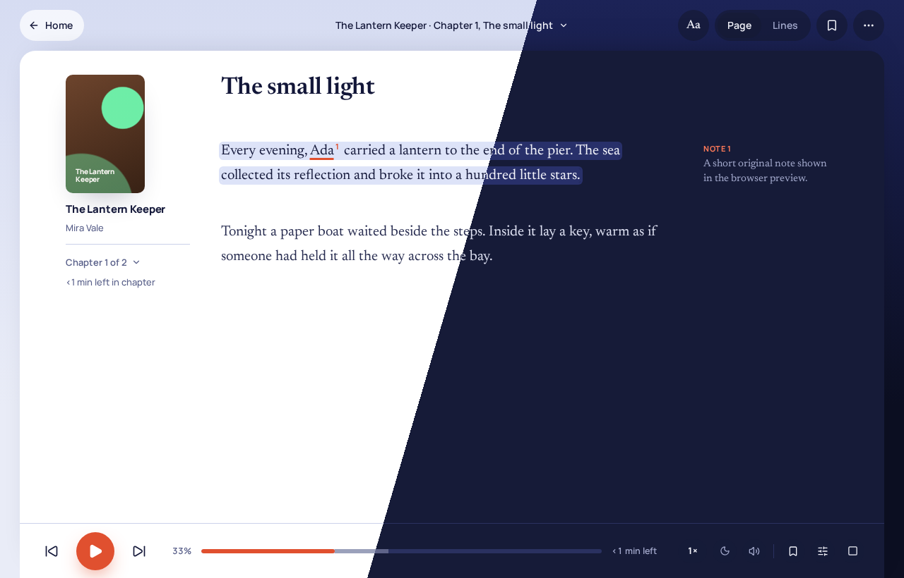
</p>

Aoide reads your EPUB books aloud with a text-to-speech engine that runs on your own machine. While it reads, the page follows along: the sentence being spoken is shaded and the current word is marked. Nothing is uploaded, nothing is subscribed to, and your books are never changed.

*Aoide* (ἀοιδή, "song") is one of the three original Muses.

> **Status:** works day to day on Linux. There are no ready-made downloads yet, so you build it from source (about ten minutes, steps below).

---

**Contents:** [What you get](#what-you-get) · [How it works](#how-it-works) · [Getting started](#getting-started) · [Using Aoide](#using-aoide) · [Where your files live](#where-your-files-live) · [Troubleshooting](#troubleshooting) · [For developers](#for-developers)

---

## What you get

- **Read along.** The current sentence and word are highlighted as they're spoken. Click any sentence to listen from there. Switch between a full *Page* view and a calm *Lines* view that shows one passage at a time.
- **Starts in seconds, not hours.** Aoide makes audio just ahead of where you're listening, so you can press play on a new book right away. If you want a book ready for later or offline, ask it to prepare the whole thing.
- **Your voice, your engine.** Works with [Chatterbox TTS Server](https://github.com/devnen/Chatterbox-TTS-Server), [Kokoro-FastAPI](https://github.com/remsky/Kokoro-FastAPI) and any other server that speaks the OpenAI speech API. Pick a different voice for each book and preview it first.
- **A real player.** Gapless playback, 0.5× to 3× speed without the chipmunk effect, sleep timer, bookmarks with notes, chapter skipping, media keys and your desktop's now-playing controls. It remembers where you stopped. The time left is at your speed, in the chapter or in the whole book (click it to switch), and its tooltip says when that runs out by the clock.
- **Footnotes done right.** Notes are left out of the narration and shown beside the text. You can have them read aloud after their paragraph instead.
- **A tidy library.** Drop EPUBs on the window, or let Aoide find the ones already scattered around your computer. Covers, progress, collections and per-book details from Open Library if you want them.
- **Articles too.** Paste a link to an article and Aoide fetches the page once, keeps its readable text, and reads or narrates it like a book. If a site shows only part of it (a sign-in, a paywall), Aoide says so instead of pretending it is complete.
- **Hard pages, if you want.** Some sites only show their text after running scripts, or ask you to sign in or prove you are a person. Turn on the browser in **Settings → Sites** and Aoide opens such pages in Chrome or Chromium on your computer, and lets you sign in or pass the check once in a window. It is off unless you turn it on.
- **Feeds.** Subscribe to a site's RSS, Atom or JSON feed and its new articles arrive in **Feeds**, checked in the background. Read one in the reader, or save it to the library to keep it. Bring your subscriptions from another reader as an OPML file.
- **Home and activity.** Home picks up where you left off and shows what is next. Activity has your time per day and per book, streaks, and a heat map of the last six months.
- **Bring your own audiobook.** Own the DRM-free audiobook of a book? Pair it with the EPUB and the narrator's recording plays with the same sentence and word highlighting. Aoide listens to it once on your computer to find where each sentence is.
- **Take it with you.** Export any book as an M4B audiobook with chapters and cover, for your phone or another player. A book paired with its audiobook exports as a read-along EPUB instead (EPUB 3 Media Overlays), which highlights each sentence in other reading apps that support them.

<table>
  <tr>
    <td width="50%">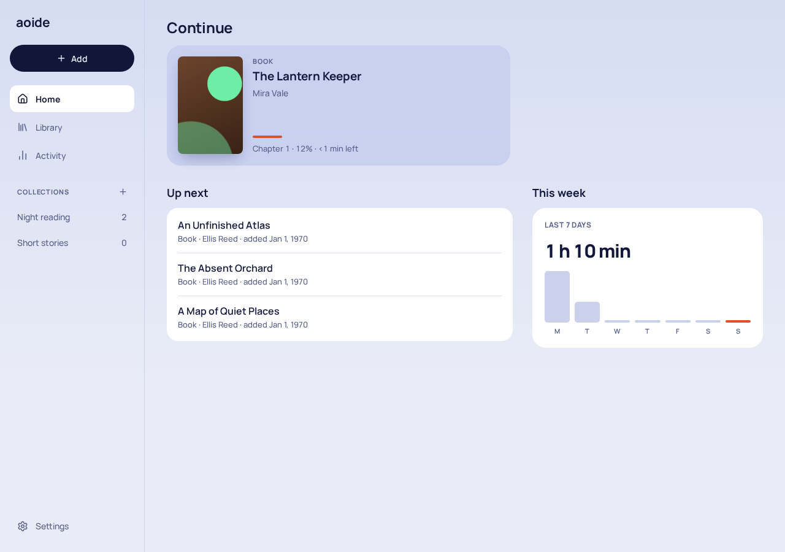<br><sub><b>Home.</b> Pick up where you left off.</sub></td>
    <td width="50%">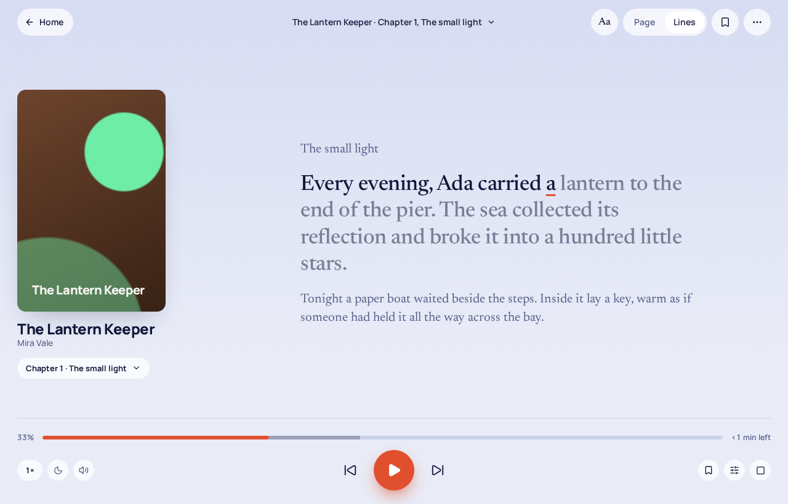<br><sub><b>Lines view.</b> One passage at a time, large and calm.</sub></td>
  </tr>
  <tr>
    <td>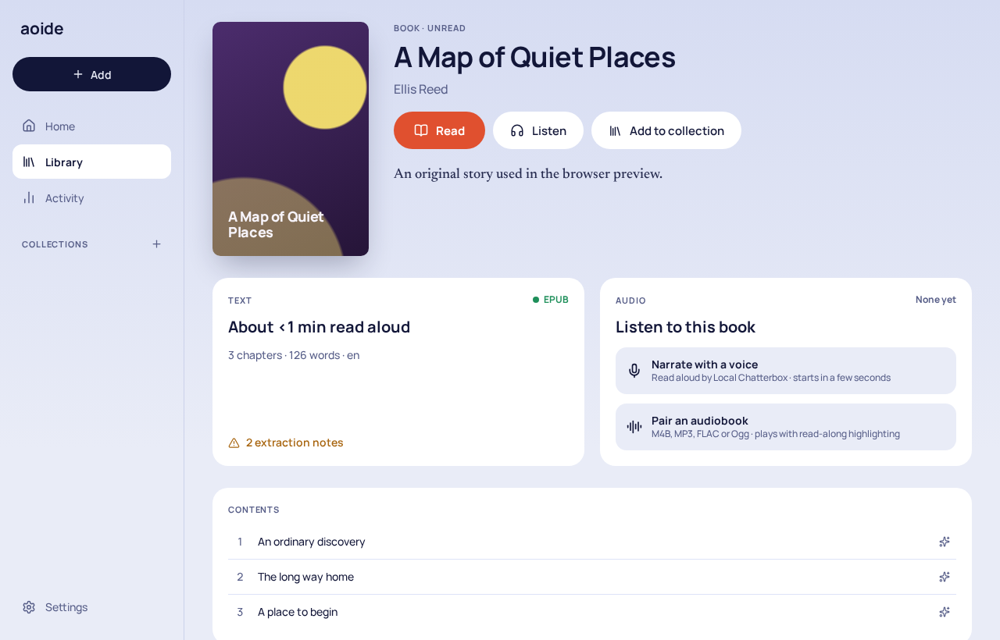<br><sub><b>Book page.</b> Its text, what plays it, and its contents.</sub></td>
    <td>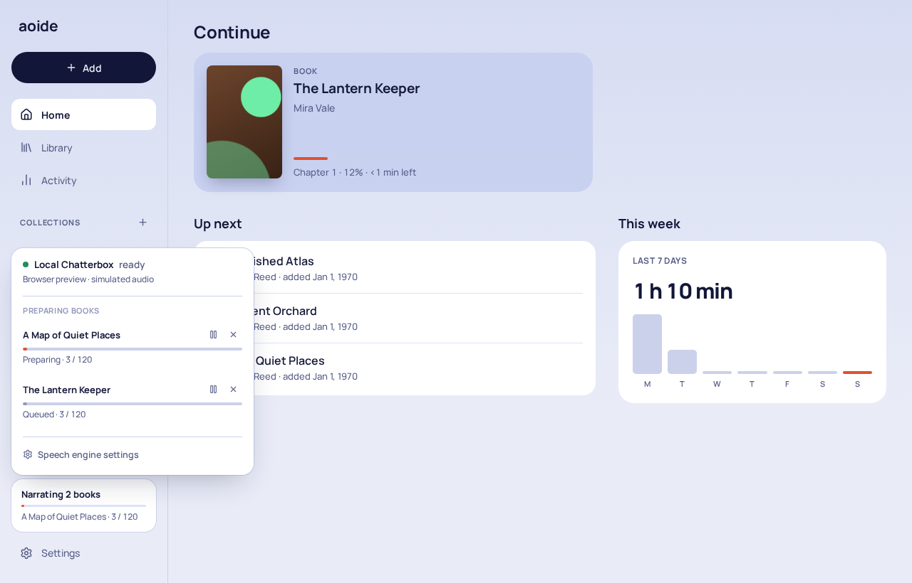<br><sub><b>Speech queue.</b> See what's being made, pause or cancel it.</sub></td>
  </tr>
  <tr>
    <td>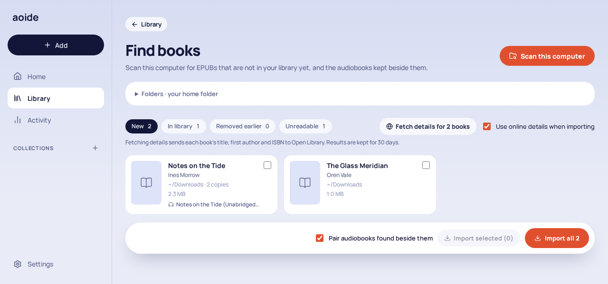<br><sub><b>Find books.</b> Gathers the EPUBs already on your computer.</sub></td>
    <td>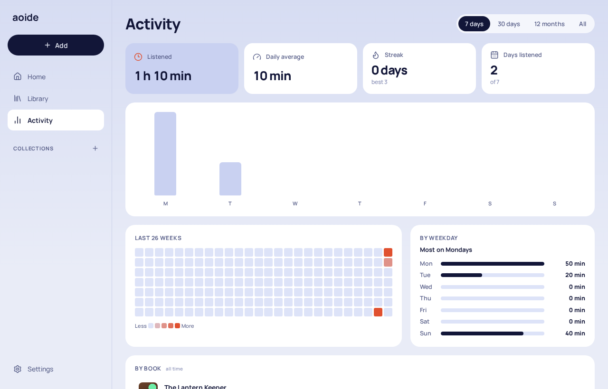<br><sub><b>Activity.</b> How much you've listened, and when.</sub></td>
  </tr>
  <tr>
    <td>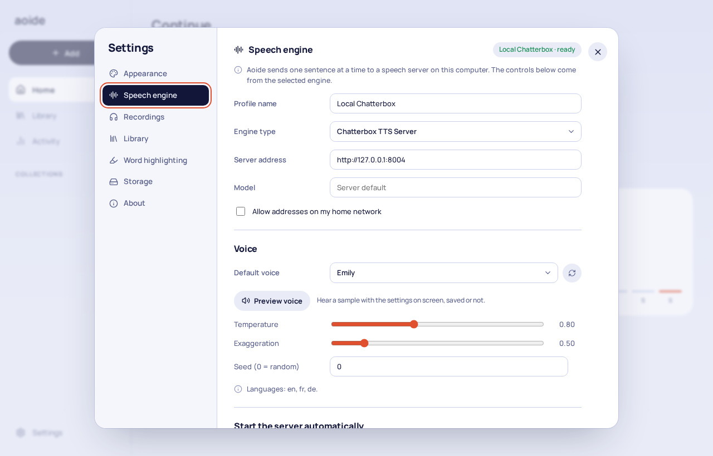<br><sub><b>Settings.</b> Choose an engine and voice, and hear it first.</sub></td>
    <td>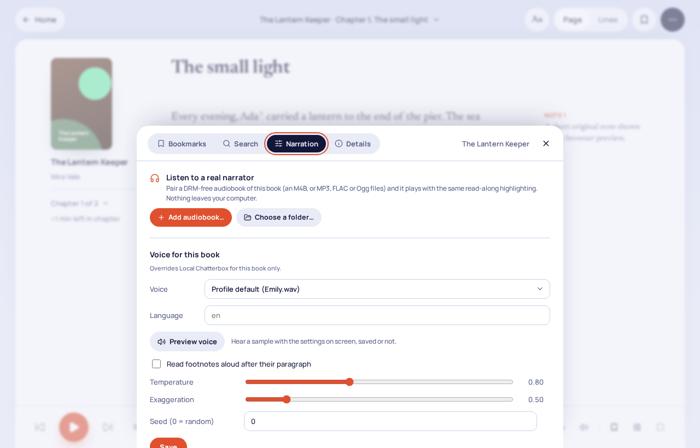<br><sub><b>Per-book voice.</b> Every book can sound different.</sub></td>
  </tr>
</table>

## How it works

<p align="center">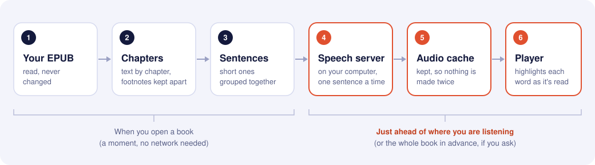</p>

Aoide sends one sentence at a time to the speech server and keeps every piece of audio it gets back, so nothing is made twice. It always works on what you'll hear next:

<p align="center">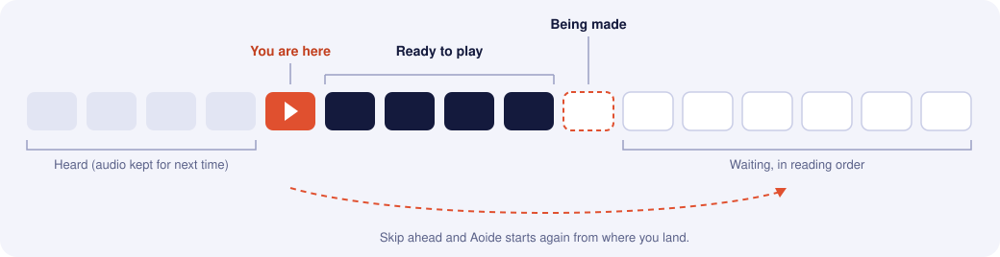</p>

When you skip around, it waits a moment for you to settle and then starts from where you landed. A whole-book preparation steps aside whenever you're listening to something else.

### What leaves your computer

<p align="center">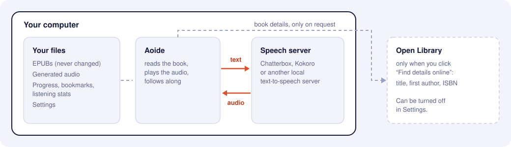</p>

- Book text goes only to the speech server you set up, and by default Aoide refuses any server that isn't on the same computer. If your speech server runs on another machine at home (say, one with a better graphics card), tick *Allow addresses on my home network* in Settings.
- Open Library sees a book's title, first author and ISBN only when you click *Find details online*. You can turn lookups off completely in Settings.
- Pairing an audiobook downloads a speech-recognition model from huggingface.co once, when you press **Download** in **Settings → Recordings**. It is checked against a fixed checksum. The recording itself is only read on your computer.
- Saving an article fetches its page (and its lead image) once, from the site you linked, with no cookies or account. Aoide only fetches public addresses, never your home network. **Try an archived copy** asks the Internet Archive (archive.org) for its copy of that page.
- Feeds you subscribe to are checked from this computer, by default once an hour, asking each site only whether its feed changed. An entry the feed gives only a summary of has its page fetched when you open it, like a saved article.
- With the browser on (**Settings → Sites**; off by default), a page that needs it is opened in Chrome or Chromium on this computer, and that browser loads the page as any browser would: its scripts, images and the other sites it calls. Like plain fetching, it can only reach public addresses. **Download Chrome** fetches Chrome for Testing from Google once, checked against a fixed checksum.
- There is no account, no telemetry and no update check.

## Getting started

You need three things: **Aoide**, a **speech server**, and **some EPUBs** without DRM.

### 1. Build Aoide

Aoide runs on **Linux** today: audio goes through PipeWire or PulseAudio, and media keys through MPRIS.

Install these first:

- [Node.js](https://nodejs.org/) 22.12 or newer, with npm
- [Rust](https://rustup.rs/), stable
- CMake and a C/C++ compiler (for the bundled Opus audio library and whisper.cpp)
- Clang's `libclang` (to build the whisper.cpp bindings)
- The [Tauri system libraries](https://v2.tauri.app/start/prerequisites/#linux) for your distribution (WebKitGTK and friends)

<details>
<summary>Example: one command for Fedora, Debian/Ubuntu or Arch</summary>

```sh
# Fedora
sudo dnf install webkit2gtk4.1-devel openssl-devel curl wget file libappindicator-gtk3-devel \
  librsvg2-devel dbus-devel pkgconf-pkg-config gcc-c++ make cmake clang-devel

# Debian / Ubuntu
sudo apt install libwebkit2gtk-4.1-dev libssl-dev curl wget file libayatana-appindicator3-dev \
  librsvg2-dev libdbus-1-dev pkg-config build-essential cmake libclang-dev

# Arch
sudo pacman -S --needed webkit2gtk-4.1 openssl curl wget file libappindicator-gtk3 librsvg \
  dbus pkgconf base-devel cmake clang
```

</details>

Then:

```sh
git clone https://github.com/Sebosun/Aoide.git
cd Aoide
npm install
npm run tauri build -- --no-bundle
```

The app is now at `target/release/aoide`. Run it from there, or copy it somewhere on your `PATH`.

<details>
<summary>Faster audiobook syncing on a graphics card</summary>

Syncing an audiobook runs speech recognition on the processor by default, at about 25 times real time (a 10-hour book takes around 25 minutes). To use an NVIDIA card instead, install the CUDA toolkit with cuBLAS, make sure `nvcc` is on your `PATH` (it is often in `/usr/local/cuda/bin`), and build with:

```sh
npm run tauri build -- --no-bundle --features whisper-cuda
```

`--features whisper-vulkan` does the same for other cards through Vulkan. **Settings → Recordings → Runs on** then chooses between the card and the processor.

</details>

### 2. Set up a speech server

Aoide doesn't contain a voice of its own; it talks to a speech server running on your computer. Pick one:

| | Sounds | Needs | Default address |
| --- | --- | --- | --- |
| **[Chatterbox TTS Server](https://github.com/devnen/Chatterbox-TTS-Server)** | Very natural, expressive, can clone a voice from a short sample | An NVIDIA GPU is strongly recommended | `http://127.0.0.1:8004` |
| **[Breeze TTS 2](https://github.com/breezeblue-ai/breeze-tts)**, through [`tools/breeze-tts`](tools/breeze-tts/aoide_breeze_tts.py) | Very natural; designs narrator voices from a description and keeps each one steady for a whole book. Weights are for non-commercial use only | An NVIDIA GPU with 12 GB, or 16 GB to keep up with fast listening (see below) | `http://127.0.0.1:8883` |
| **[Qwen3-TTS](https://github.com/QwenLM/Qwen3-TTS)**, through [`tools/qwen-tts`](tools/qwen-tts/aoide_qwen_tts.py) | Natural, nine built-in voices (two of them English), about 3–4× real time | An NVIDIA GPU with about 5 GB free; setup is in the script's header | `http://127.0.0.1:8882` |
| **[Kokoro-FastAPI](https://github.com/remsky/Kokoro-FastAPI)** | Clear and pleasant, many stock voices | Runs fine on a CPU | `http://127.0.0.1:8880` |
| Anything else with an OpenAI-style `/v1/audio/speech` endpoint | – | – | your choice |

Follow the server's own install guide. Aoide is set up for Chatterbox out of the box; for anything else open **Settings → Speech engine**, choose *OpenAI-compatible speech server* and enter its address.

<details>
<summary>Setting up Breeze TTS 2</summary>

Breeze has no server of its own that Aoide can use, so this repository includes a small one. Install Breeze and download the weights (7.2 GB) next to it:

```sh
git clone https://github.com/breezeblue-ai/breeze-tts.git && cd breeze-tts
uv venv --python 3.12 --python-preference only-managed venv
VIRTUAL_ENV=venv uv pip install -r requirements.txt
venv/bin/hf download BreezeBlue/Breeze-TTS-2 --local-dir ../breeze-tts-2
```

Start it once in normal mode. On the first start it designs three narrator voices, Hazel, Arthur and Nell, and keeps them in `~/.local/share/aoide/breeze-voices`:

```sh
venv/bin/python path/to/aoide/tools/breeze-tts/aoide_breeze_tts.py --breeze . --model ../breeze-tts-2
```

Breeze runs in one of two modes. Measured on a 16 GB graphics card:

| | Normal | Fast (`--fast`) |
| --- | --- | --- |
| Video memory | about 9 GB | about 11 GB |
| Speed | about 0.9× real time: too slow to listen live, so prepare books ahead | about 2.3× real time: keeps up even at 2× playback |
| Start-up | a few seconds | about 15 seconds |
| Designing voices | yes | no; design them in normal mode, then restart with `--fast` |

Fast mode is what you want if your card has room for it. Use normal mode on a 12 GB card, or when something else, such as a game, needs the GPU.

To add a voice, describe it: `--design "Mara" "A warm woman in her forties, low and unhurried."` (normal mode, it saves the voice and exits). Or drop a clean 5–15 second recording you have the rights to into the voices folder as `Mara.wav`, with its exact transcript as `Mara.txt`.

</details>

The pill in the top right corner tells you whether Aoide can reach the server. When it says **ready**, you're set.

> **Tip:** under **Settings → Speech engine → Start the server automatically** you can give Aoide the command that starts your server. It will then start it the first time you listen, prepare a book or try a voice (only reading starts nothing), and you can forget about it. While the model loads the player says *Starting the voice…*. If the server ends instead, Aoide says so, with its exit code; what it printed is in `speech-server.log` in Aoide's logs folder. After 30 minutes unused Aoide stops it, which frees the graphics card's memory, and starts it again the next time speech is needed (playing audio that is already made needs none); **Stop when idle** changes the time or turns it off, and **Stop now** (there, or in the speech card's panel in the sidebar) frees the graphics card at once. If the server fails, the same place shows its last lines with **Try again** and **Show log**. A server you started yourself is used as it is and never stopped. One Aoide started does not outlive it: quitting, Ctrl+C in the terminal, or even a crash stops it (on Linux, a crash is caught at once or at the next start), along with anything its command started, such as the Python behind `uv run`.

### 3. Add books

Any of these works:

- Drag `.epub` files onto the window.
- Click **Add** in the sidebar (or press <kbd>Ctrl</kbd> <kbd>N</kbd>), then **Choose books…**.
- Click **Add → Scan for books…** to find EPUBs on your computer you haven't added yet.
- Copy files into `~/Documents/Aoide/Books` yourself. Aoide notices.
- For an article, paste its link anywhere on the window (or drop it there), or put it in **Add → A link to an article or a feed**, and press **Save article**. A feed's address there subscribes to it instead.
- For a feed, press **Subscribe** in **Feeds** and give the feed's address or just the site's; a site with several feeds lets you pick. **Settings → Feeds → Import…** takes an OPML list from another feed reader.

Open a book and read, or press **Listen**.

## Using Aoide

**Listening.** Press <kbd>Space</kbd> to play or pause and <kbd>←</kbd> <kbd>→</kbd> to move a sentence. Click any sentence to jump there. If you scroll away while listening, the page stops following you until you click *Back to playhead*. If the voice garbles, repeats or cuts off a sentence, press **Say this again** (the circling arrow at the top of the reader) while it is spoken: Aoide throws away that sentence's audio and makes it again, read differently, then plays it, or waits there if you had paused. The rest of the book's audio is left alone, and a prepared book stays prepared. The voice leaves a short pause after each paragraph, a longer one at a scene break (a line such as `* * *`, or a rule) and after headings and chapters. Set their length under **Settings → Speech engine → Pauses** and press **Hear it** to try them before saving; changing them makes no audio again. Come back after a break and playback starts a little earlier so you catch the thread: from the start of the sentence after a short pause, a sentence back after five minutes, two after an hour (an audiobook without text goes back 3, 10 or 20 seconds), never into the chapter before. Turn it off under **Settings → Library → Listening**.

**Preparing ahead.** On a book's page, **Prepare whole book** makes all its audio in the background, so it plays instantly later, even with the speech server off. While books are being prepared, a **Narrating** card in the sidebar shows progress; click it to see the queue, pause it or cancel. Unfinished books carry on next time you start Aoide (you can turn that off under **Settings → Library**).

**A voice per book.** In the reader, open the book tools (the sliders icon in the player) and go to **Narration**. Choose a voice, language and settings for just this book, and press **Preview voice** to hear a sample before saving. Changing the voice later lets you regenerate the book's audio.

**Saying a word right.** If the voice says a name wrong, tell it how: select the word in the reader and press **Say this differently…** (the spell-check icon at the top), or add it under **Narration → Pronunciation** in the book tools. Write it as it should sound ("Hermione" as "her-MY-oh-nee", "SQL" as "sequel"), press **Hear it** to check, and save. Aoide says how many sentences of the book have the word before you save. The page keeps the book's spelling and the highlight stays on the written word; only the sentences with the word are made again, from where you are listening, and a prepared book offers to prepare the rest. A word matches as a whole word, in any case unless you tick **Only with this exact case**, and with a plural or possessive ending ("Xu's"). **Settings → Speech engine → Pronunciation** holds the list for every book; a book's own list wins over it. Both lists are kept in Aoide's library, never in the book file.

**Exporting.** **Export as M4B**, in a book's menu in the library or under **Narration** in the book tools, saves an audiobook file with chapter marks and cover to `~/Documents/Aoide/Exports`. This needs [`ffmpeg`](https://ffmpeg.org/) installed. A book whose own audiobook is synced offers **Export read-along EPUB** instead. It saves `<title> (read-along).epub` there: the text with the recording inside, which other reading apps with EPUB 3 Media Overlays play with sentence highlighting. MP3, M4B/M4A and Ogg Opus recordings go in unchanged. Other formats are converted with ffmpeg. Images and the book's own styling are not carried over.

**Your own audiobook.** Drop the audiobook's files (M4B, M4A, MP3, FLAC, Ogg or WAV; one file or a folder of parts) on the window, or choose **Add audiobook…** in a book's menu, then pick the book it reads. Aoide first checks three short samples against the text, then listens to the whole recording in the background; the sidebar shows its progress and you can pause it. The first time, it asks you to download a speech-recognition model (about 140 MB) in **Settings → Recordings**. You don't have to wait: **Listen now** plays what is synced so far, and if you catch up with the sync, playback waits for it. When it's done, the book plays the recording instead of the speech engine, with the same highlighting and controls. **See the report** on the book's page shows how much of the text was found in each chapter and lists narration that isn't in the text, such as credits. Under **Narration** in the book tools you can switch a book back to the speech engine at any time, or turn on **Speak what the recording lacks**: chapters and passages the narrator skipped are then read by the speech engine in the book's voice instead of being passed over. Sentences that were read aloud but not recognised are left to the recording, so nothing is heard twice. **Find books** also looks beside each EPUB it finds for that book's audiobook: a file or folder with the book's title in its name, in the same folder or the one above. New books can be imported with their audiobooks paired, and a book already in the library gets a **Pair…** button that opens the same check. For books already in your library, **Add → Find audiobooks…** searches your home folder (or the folders you set there) and lists each book without a recording next to up to three audiobooks with close names: most of the title's words, a misspelling allowed. An audiobook with exactly the title's words is listed alone, and an audiobook is offered only to the book it fits best, so one audiobook is never paired with two books. Pick one per book and pair the ones you select, or all of them. Books you add later are looked up too, and the screen opens when audiobooks were found for them. If you'd rather not confirm each one, turn on **Settings → Recordings → Let Aoide verify audiobook matches**. Aoide then pairs each book's closest audiobook itself. If the quick check fails, it tries the next audiobook, and leaves the book unpaired if none pass. Your audio files are never changed or copied, and recordings protected by DRM (Audible AAX, for example) can't be used.

**Articles.** A saved article shows in the library as a tile with its site and first lines while it is fetched. Read it, or press **Listen** to have it narrated; its headings are in the reader's header, where a book has its chapters. If the page gave only part of the article, it is marked **Needs you** and the reader explains why after the text: **Fetch again**, **Try an archived copy**, or **Open original** to read it on the site. A copy is replaced only by a fuller one. Pairing an audiobook and looking up details online are for books only.

**Feeds.** **Feeds** in the sidebar shows how many entries are new. Its screen lists **All new**, **Saved for later** and each subscription; new entries are grouped by day with their feed, age and reading time, or *summary only* when the feed carries just a summary (the page is then fetched when you open it). Opening an entry marks it read and shows it in the reader, where **Save to library** keeps it; the bookmark button beside each entry does the same, and pressed again takes it out. A feed that stops answering says since when, and is asked less often until it answers again. **Check now** checks every feed; **Mark all read** clears the dots of the list shown. A subscription's **⋯** menu unsubscribes, copies the feed's address or opens its site. Entries you did not save are deleted after a while: read ones after 30 days, unread ones after 90 (change both, and how often feeds are checked, in **Settings → Feeds**). An article whose site has a feed you don't follow offers **Subscribe** under its byline.

**Notifications.** When a long job ends while Aoide is not in front, the desktop tells you: a book prepared, an audiobook synced, an export written or found books imported, once they took more than a minute. A preparation that stalls because the speech engine failed, a sync that needs a look or failed, and a failed export are told at once. Click one to bring Aoide to the front on that book's page. Feeds never notify. Turn them off under **Settings → Library → Notifications**. On Linux they go to your desktop's notification service; nothing is sent elsewhere yet.

**Storage.** Generated audio is kept so nothing is made twice. Set a size limit in **Settings → Storage**; the oldest audio goes first, never the book you're listening to or preparing.

**Exact word timing (optional).** By default Aoide places each word by listening for the pauses in the audio, which is close but not perfect. For word-exact highlighting, run the small aligner in [`tools/aligner`](tools/aligner/aoide_aligner.py) in any Python environment with `torch` and `torchaudio` 2.1+ (your Chatterbox environment works):

```sh
python tools/aligner/aoide_aligner.py --port 8890
```

Then turn on **Settings → Word highlighting → Exact word timing** with the address `http://127.0.0.1:8890`. The first start downloads a 1.2 GB model. It uses about 1 GB of video memory; add `--device cpu` to keep the GPU free for your speech server, at about half a second per sentence. Each sentence is aligned once, just before it plays. It works for a paired audiobook too: its sentences are aligned as they play, each once per run. Words the model can't spell (numbers, non-Latin scripts) fall back to the estimate. If you give Aoide the command that starts the aligner there, it is started and stopped the way the speech server is: when a sentence needs aligning, never left behind, and with what it prints in `aligner.log`.

### Keyboard shortcuts

| Keys | Does |
| --- | --- |
| <kbd>Space</kbd> | Play or pause |
| <kbd>←</kbd> / <kbd>→</kbd> | Previous or next sentence |
| <kbd>Shift</kbd> <kbd>←</kbd> / <kbd>Shift</kbd> <kbd>→</kbd> | Previous or next chapter |
| <kbd>Ctrl</kbd> <kbd>←</kbd> / <kbd>Ctrl</kbd> <kbd>→</kbd> | Back or forward 30 s, or three sentences |
| <kbd>[</kbd> / <kbd>]</kbd> | Slower or faster by 0.1× |
| <kbd>\\</kbd> | Back to 1× |
| <kbd>Shift</kbd> <kbd>↑</kbd> / <kbd>Shift</kbd> <kbd>↓</kbd> | Volume up or down by 10% |
| <kbd>M</kbd> | Mute or unmute |
| <kbd>B</kbd> | Bookmark here |
| <kbd>T</kbd> | Sleep timer |
| <kbd>Ctrl</kbd> <kbd>F</kbd> | Search the open book, or the library |
| <kbd>Ctrl</kbd> <kbd>N</kbd> | Add books or audiobooks |
| <kbd>Ctrl</kbd> <kbd>,</kbd> | Settings |
| <kbd>Ctrl</kbd> <kbd>+</kbd> | Larger interface |
| <kbd>Ctrl</kbd> <kbd>−</kbd> | Smaller interface |
| <kbd>Ctrl</kbd> <kbd>0</kbd> | Interface at 100% |
| <kbd>Esc</kbd> | Close a dialog or menu, or leave the reader |
| <kbd>?</kbd> | Show this list |

<kbd>Ctrl</kbd> + mouse wheel changes the interface size too. While you type in a field, only the <kbd>Ctrl</kbd> shortcuts for search, Add, Settings and size work (<kbd>Ctrl</kbd> <kbd>←</kbd> / <kbd>→</kbd> move by word as usual), and the player's keys wait while a dialog is open. ↑ and ↓ alone keep scrolling. <kbd>T</kbd> opens the sleep timer's menu in the player, over the card at the foot of the sidebar, or at the foot of a book you read while another plays.

The same list is in **Settings → About**, and <kbd>?</kbd> shows it anywhere.

## Where your files live

| What | Where |
| --- | --- |
| Your books | `~/Documents/Aoide/Books` (add your own scan folders under **Find books**) |
| Exported audiobooks and read-along EPUBs | `~/Documents/Aoide/Exports` |
| Settings | `~/.config/aoide/settings.toml` |
| Colour themes | `~/.config/aoide/themes/*.toml` |
| Library, progress, bookmarks, covers | `~/.local/share/com.aoide.audiobooks` |
| Saved articles (each page as fetched, and its image) | `~/.local/share/com.aoide.audiobooks/articles` |
| Speech-recognition models | `~/.local/share/com.aoide.audiobooks/models` |
| The browser's profile (sign-ins, cookies and site data for articles) | `~/.local/share/com.aoide.audiobooks/browser/profile` |
| A browser downloaded by Aoide | `~/.local/share/com.aoide.audiobooks/browser/chrome` |
| Per-site fetch rules | `~/.config/aoide/site-rules.toml` |
| Generated audio | `~/.cache/com.aoide.audiobooks` (safe to delete; it's made again when needed) |

Books are recognised by their content, not their file name, so renaming or moving a file keeps your progress. If a file disappears, the book stays in your library as *missing* and comes back when the file does.

<details>
<summary>Editing settings by hand, and custom colour themes</summary>

`settings.toml` holds appearance, playback speed, app settings and the speech engine. Edit it while Aoide is running and the changes apply as soon as you save.

Aoide comes with one built-in theme, **Default**, in a light and a dark version. **Settings → Appearance** picks the theme and whether to use light, dark, or follow your system.

To make your own, add a file to `~/.config/aoide/themes/`, for example `sepia.toml`. It has a `[light]` and a `[dark]` table, and any colour you leave out keeps its Default value, so a theme can be as small as one line. Here is the whole Default theme to start from:

```toml
[light]
ground = "#E9ECF7"       # window background
cover-tint = "#D6DCF2"   # top of the window background, fading into ground
page = "#FFFFFF"         # reading page and cards
ink = "#121638"          # headings and main text
reading = "#262B4F"      # book text
dim = "#575E88"          # secondary text
faint = "#9298BC"        # hints and placeholders
line = "#CBD1EA"         # borders and dividers
glass = "rgba(255, 255, 255, .72)"  # translucent panels
hero = "#C9D1F1"         # the first Continue card on Home
wash = "#DDE3F8"         # the sentence being read, hovers, soft fills
accent = "#E0502F"       # buttons, current word, progress
on-accent = "#FFFFFF"    # text on accent
ok = "#1E8F5A"           # "ready"
warn = "#A8650F"         # warnings
shadow = "rgba(18, 22, 56, .32)"

[dark]
ground = "#0C0F22"
cover-tint = "#1C2357"
page = "#161B38"
ink = "#F2F3FA"
reading = "#DFE2F3"
dim = "#A3A9CC"
faint = "#5E658F"
line = "#2A3160"
glass = "rgba(22, 27, 56, .78)"
hero = "#222A63"
wash = "#28306A"
accent = "#FF7A59"
on-accent = "#1E0F0A"
ok = "#4FD495"
warn = "#E9A94B"
shadow = "rgba(0, 0, 0, .6)"
```

Colours can be hex (`#rgb`, `#rrggbb`, with or without alpha), `rgb()`, `rgba()`, `hsl()`, `hsla()` or `oklch()`. Save the file and it appears in **Settings → Appearance**. Aoide only reads theme files and never changes them.

Per-book settings, progress and bookmarks live in the library database, not in these files.

</details>

## Troubleshooting

**The player or a book's page says the engine is offline.** Aoide can't reach the speech server. Check that it's running and that the address in **Settings → Speech engine** matches the one the server prints when it starts. If the server is on another computer, tick *Allow addresses on my home network*.

**Play does nothing, or there's no sound.** Aoide plays through `pw-cat` (PipeWire), `paplay` (PulseAudio) or `aplay` (ALSA), whichever it finds first. Make sure one of them is installed; on most desktops `pw-cat` already is.

**It pauses now and then to catch up.** The speech server is slower than you're listening. Lower the playback speed, use a faster engine, or prepare the book ahead of time.

**A book's chapters look wrong, or some text is missing.** In the reader, open the book tools and go to **Details**: *Extraction notes* lists anything Aoide left out (copyright pages, tables of contents and the like) and why, plus any warnings. Some EPUBs have poor navigation, so chapters may be grouped differently from the printed book. Your file is never modified.

**An audiobook won't pair, or syncs badly.** *Protected by DRM* means the files only play in their store's app; Aoide can't use them. *Doesn't match the book* after the quick check usually means another book, edition or language; choose **Use it anyway** if you're sure. A low share in the sync report points to an abridged recording or a different edition; chapters it couldn't find are skipped while the recording plays, unless you turn on **Speak what the recording lacks** under **Narration**. If you move or rename the audio files, the book shows *Audio files missing* and speaks with the speech engine; put the files back and Aoide notices within a minute.

**Syncing is slow.** It runs at about 25 times real time on a processor. Choose a smaller model in **Settings → Recordings**, raise the thread count, or build with a graphics card (see *Build Aoide*). If you already run a speech-recognition server with the OpenAI transcription API and word timestamps (faster-whisper-server, LocalAI), choose **A recognition server** there instead; like the speech server, it must be on this computer unless you allow your home network. Syncing pauses when you quit and carries on next time.

**An article says *Needs you* or *Could not be fetched*.** *Needs you* means the page held back part of the article (a sign-in, a paywall, a check that you are a person) or looked cut short; what was captured is still readable. **Try an archived copy** often has the whole text. With the browser on, the notice offers to sign in or pass the check in a window; once that is done the article is fetched again, and later articles from the site use the same sign-in if you chose **Stay signed in**. *Could not be fetched* gives the reason on its card; a page that only shows its text after running scripts needs the browser.

**The browser for articles.** It is off by default, and while it is off Aoide never looks for, downloads or starts a browser. In **Settings → Sites**, *When plain fetching fails* uses it only for pages that came back cut short or behind a check; *Always* uses it for every article (slower). Aoide uses Chrome or Chromium if one is installed (or the program you choose), else offers **Download Chrome** (about 200 MB). It runs with its own profile, apart from your everyday browser; signing in there stores that site's cookies in the profile. Each site can be set to fetch with the browser or plainly, and to keep or clear its data between fetches. **Sign out** or **Forget** a site there, **Remove all site data** to empty the profile, and **Remove downloaded browser** to delete the download; the folders are listed under *Where your files live*. The browser stops a minute after its last page, and when you quit.

**Export as M4B is missing or fails.** Install `ffmpeg` and make sure it's on your `PATH`.

**The word highlight drifts a little.** That's the estimate at work. Try *Exact word timing* above.

Still stuck? [Open an issue](https://github.com/Sebosun/Aoide/issues) and say what you did, what you expected and what happened.

## For developers

Aoide is a [Tauri 2](https://v2.tauri.app/) app: the core is Rust, the interface is Vue 3 + TypeScript.

```sh
npm install
npm run tauri dev    # the desktop app, with hot reload
npm run dev          # the interface alone in a browser, with sample books and fake audio
npm test             # Rust tests for all library crates (no GPU or WebKit needed)
npm run test:core    # the app's core (builds the Tauri crate)
npm run test:ui      # interface tests (Vitest)
npm run typecheck    # Vue templates + TypeScript
npm run check        # rustfmt + Clippy on every crate, the app's included, warnings denied
```

The browser preview at `http://127.0.0.1:1420` runs the whole interface against a mock backend with original sample books. URL parameters such as `?view=reader&theme=dark&mode=lines` open a screen in a known state; see [`src/preview.ts`](src/preview.ts).

<details>
<summary>Project layout</summary>

| Crate | What it does |
| --- | --- |
| [`crates/epub-parser`](crates/epub-parser/README.md) | Reads an EPUB into ordered chapters of typed blocks, with metadata, cover, excluded front/back matter (with reasons) and warnings. Deterministic, no network. |
| `crates/document` | The parsed-book model (chapters of typed blocks, warnings) shared by EPUBs and articles. |
| `crates/article` | Extracts an article's readable text, metadata and completeness from a stored web page. Deterministic, no network. |
| `crates/fetch` | Fetches a page once over plain HTTP: public addresses only, redirects checked, size and time limits; the Internet Archive lookup; feeds with conditional requests. |
| `crates/feeds` | Parses RSS, Atom and JSON feeds into entries with stable ids, and reads and writes OPML subscription lists. Deterministic, no network. |
| `crates/segmenter` | Splits text into sentences and speech segments with stable ids; estimates word timings. |
| `crates/tts` | The `SpeechEngine` trait every engine implements, settings descriptors for the UI, address rules, cache keys, and a conformance kit for adapters. |
| [`crates/chatterbox-client`](crates/chatterbox-client/README.md) | Chatterbox TTS Server adapter. |
| `crates/openai-speech` | Adapter for OpenAI-compatible `/v1/audio/speech` servers. |
| `crates/generation` | Decides what to make next (playhead first) and runs one request at a time. |
| `crates/audio` | Ogg Opus encoding, the gapless, time-stretching player, and output to `pw-cat`/`paplay`/`aplay`. |
| `crates/library` | SQLite store for books, progress, the audio cache index, bookmarks, stats and per-book settings. |
| `crates/discovery` | Fast parallel search on disk: EPUBs for *Find books*, the audiobook kept beside each EPUB, and audiobooks with close names for *Find audiobooks*. |
| `crates/metadata` | Open Library search, descriptions and covers. |
| `crates/recording` | Reads an audiobook's files (M4B, MP3, FLAC, Ogg, WAV) as one timeline with chapters, and spots DRM. |
| `crates/transcribe` | Speech recognition with whisper.cpp, model list with checksums. |
| `crates/sync` | Matches recognised words to the book's sentences; deterministic, no audio. |
| `crates/aligner` | Client for the optional forced aligner in `tools/aligner`. |
| `crates/config` | `settings.toml` and colour themes. |
| `src-tauri` | Wires it all together: commands, events, and the core's state machines. |
| `src` | The Vue interface. `src/api/contract.ts` is generated from the Rust types. |

</details>

- **Add a speech engine:** if it speaks the OpenAI speech API, it already works. Otherwise implement one Rust trait; see [docs/adding-an-engine.md](docs/adding-an-engine.md).
- **Conventions** (tests first, explicit state machines, BEM in Vue, keeping personal books out of Git): [AGENTS.md](AGENTS.md).
- **What's next:** [docs/roadmap.md](docs/roadmap.md).

Test books are tiny EPUBs generated in the tests from original text. Please keep real books and generated audio out of the repository.

## Licence

[MIT](LICENSE). The bundled Manrope and Newsreader fonts are under the [SIL Open Font License](src/assets/fonts/OFL-Newsreader.txt).
