<h1 align="center">Aoide</h1>

<p align="center">
  <strong>Turn your EPUBs into audiobooks on your own computer, and follow along word by word.</strong>
</p>

<p align="center">
  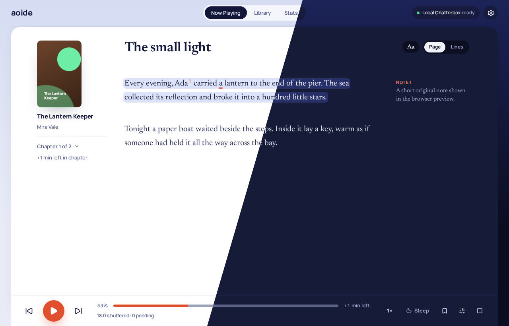
</p>

Aoide reads your EPUB books aloud with a text-to-speech engine that runs on your own machine. While it reads, the page follows along: the sentence being spoken is shaded and the current word is marked. Nothing is uploaded, nothing is subscribed to, and your books are never changed.

*Aoide* (ἀοιδή, "song") is one of the three original Muses.

> **Status:** works day to day on Linux. There are no ready-made downloads yet, so you build it from source (about ten minutes, steps below).

---

**Contents:** [What you get](#what-you-get) · [How it works](#how-it-works) · [Getting started](#getting-started) · [Using Aoide](#using-aoide) · [Where your files live](#where-your-files-live) · [Troubleshooting](#troubleshooting) · [For developers](#for-developers)

---

## What you get

- **Read along.** The current sentence and word are highlighted as they're spoken. Click any sentence to listen from there. Switch between a full *Page* view and a calm *Lines* view that shows one passage at a time.
- **Starts in seconds, not hours.** Aoide makes audio just ahead of where you're listening, so you can press play on a new book right away. If you want a book ready for later or offline, ask it to prepare the whole thing.
- **Your voice, your engine.** Works with [Chatterbox TTS Server](https://github.com/devnen/Chatterbox-TTS-Server), [Kokoro-FastAPI](https://github.com/remsky/Kokoro-FastAPI) and any other server that speaks the OpenAI speech API. Pick a different voice for each book and preview it first.
- **A real player.** Gapless playback, 0.5× to 3× speed without the chipmunk effect, sleep timer, bookmarks with notes, chapter skipping, media keys and your desktop's now-playing controls. It remembers where you stopped.
- **Footnotes done right.** Notes are left out of the narration and shown beside the text. You can have them read aloud after their paragraph instead.
- **A tidy library.** Drop EPUBs on the window, or let Aoide find the ones already scattered around your computer. Covers, progress, collections and per-book details from Open Library if you want them.
- **Listening stats.** Time per day and per book, streaks, and a heat map of the last six months.
- **Take it with you.** Export any book as an M4B audiobook with chapters and cover, for your phone or another player.

<table>
  <tr>
    <td width="50%">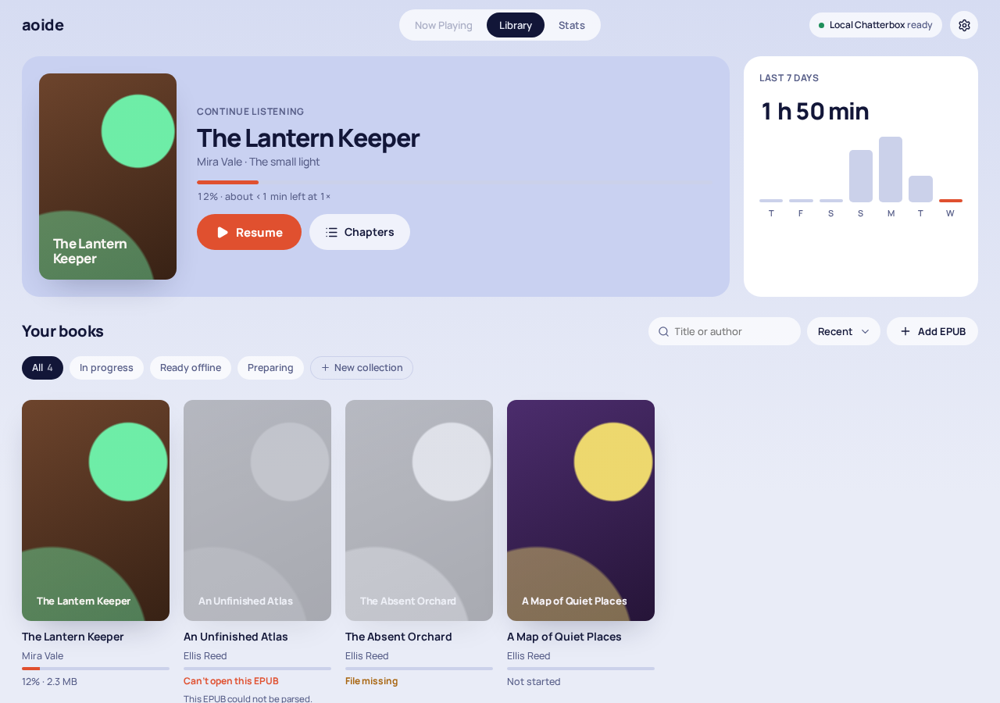<br><sub><b>Library.</b> Pick up where you left off.</sub></td>
    <td width="50%">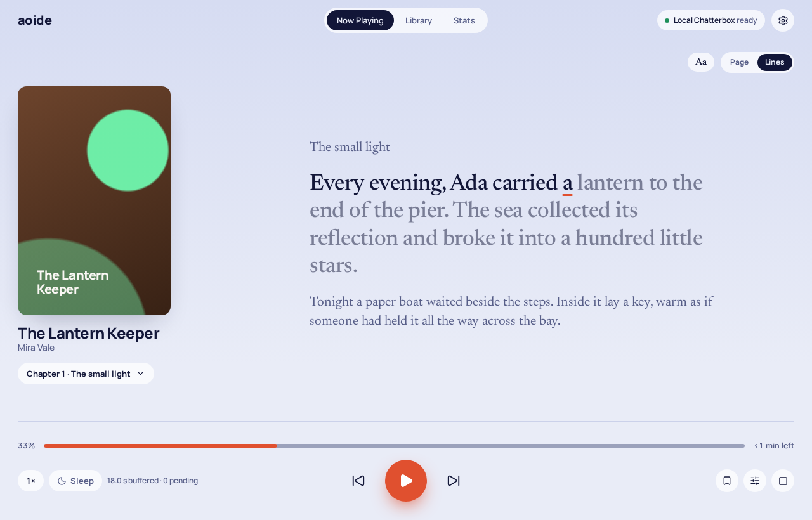<br><sub><b>Lines view.</b> One passage at a time, large and calm.</sub></td>
  </tr>
  <tr>
    <td>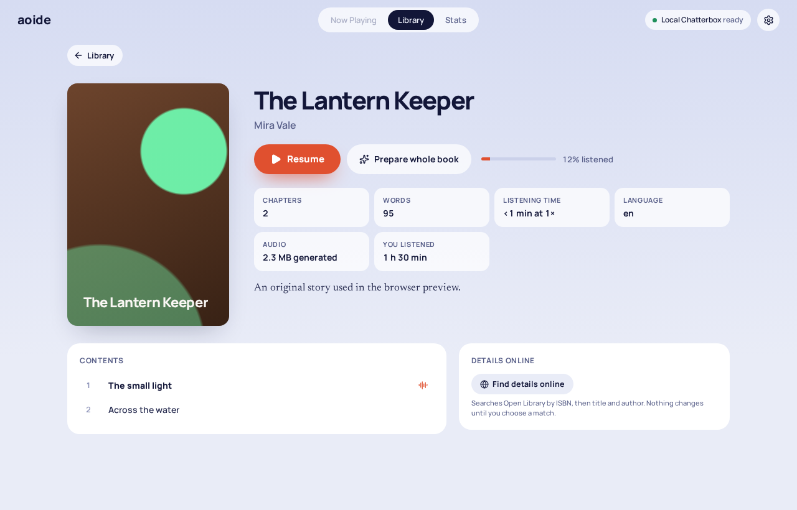<br><sub><b>Book page.</b> Contents, length and audio at a glance.</sub></td>
    <td>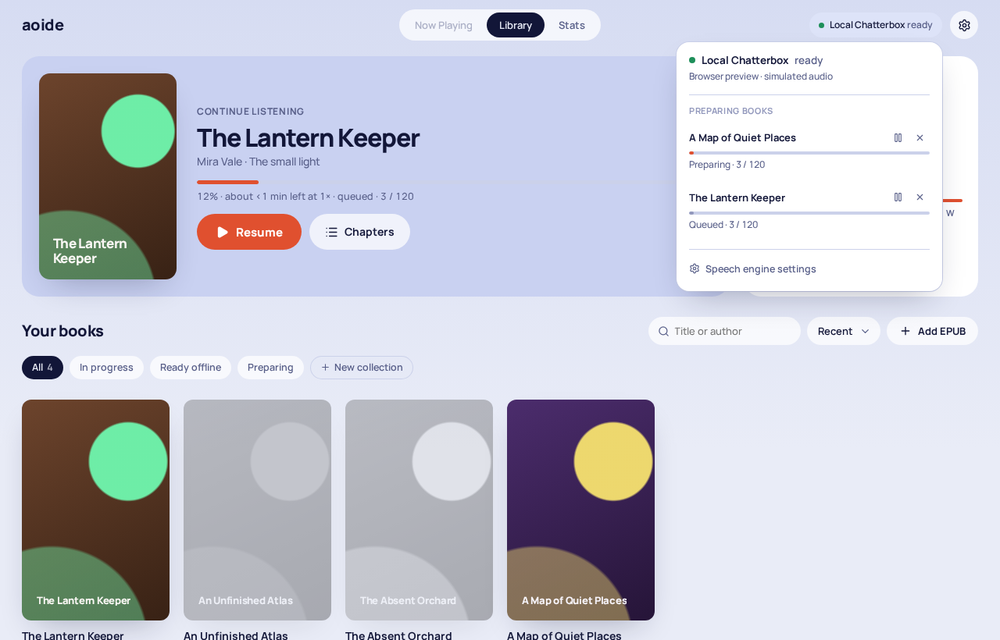<br><sub><b>Speech queue.</b> See what's being made, pause or cancel it.</sub></td>
  </tr>
  <tr>
    <td>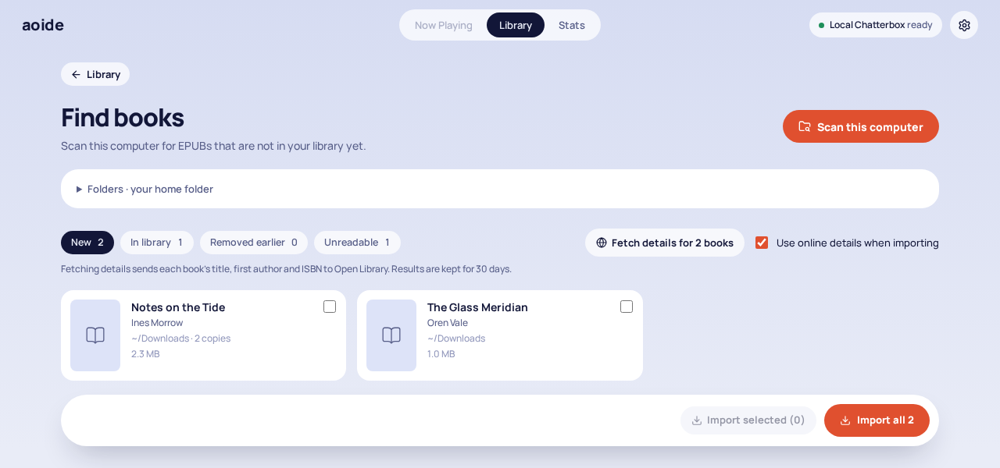<br><sub><b>Find books.</b> Gathers the EPUBs already on your computer.</sub></td>
    <td>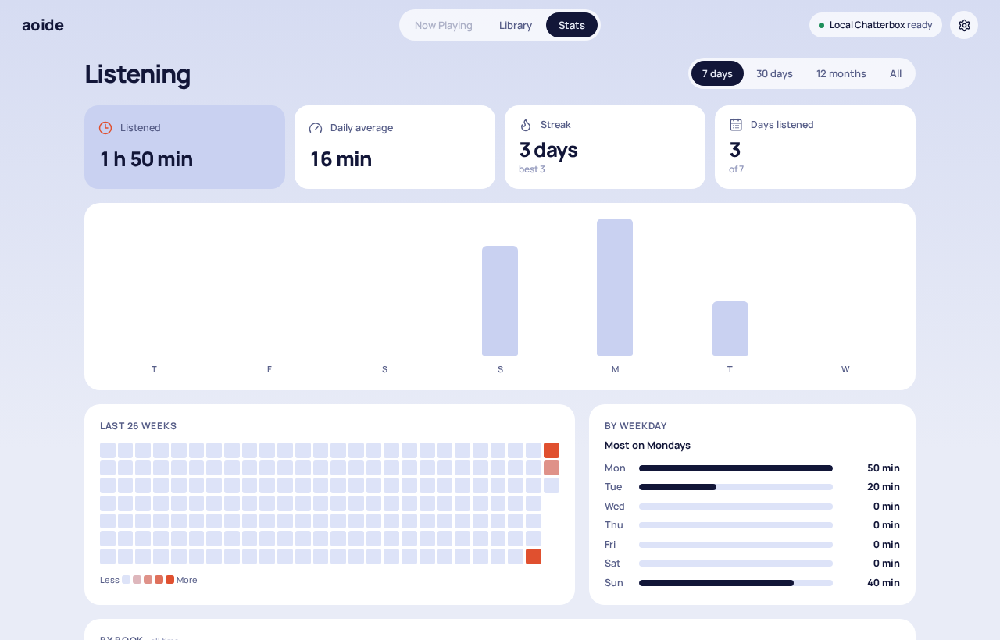<br><sub><b>Stats.</b> How much you've listened, and when.</sub></td>
  </tr>
  <tr>
    <td>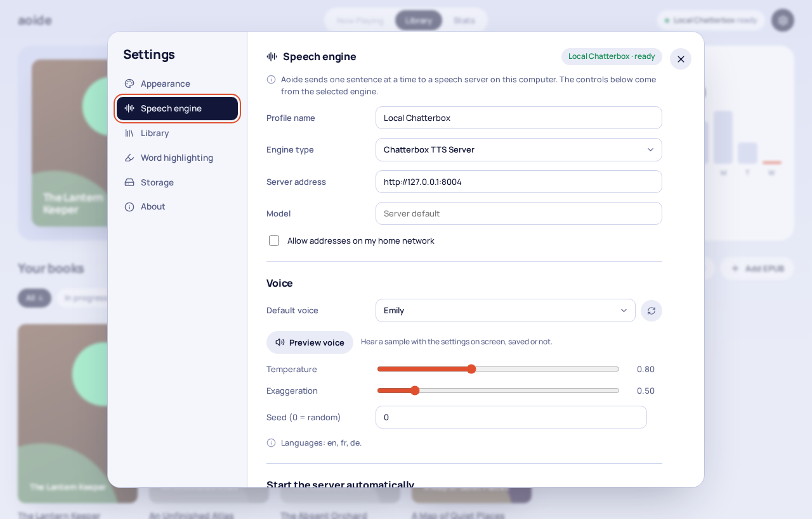<br><sub><b>Settings.</b> Choose an engine and voice, and hear it first.</sub></td>
    <td>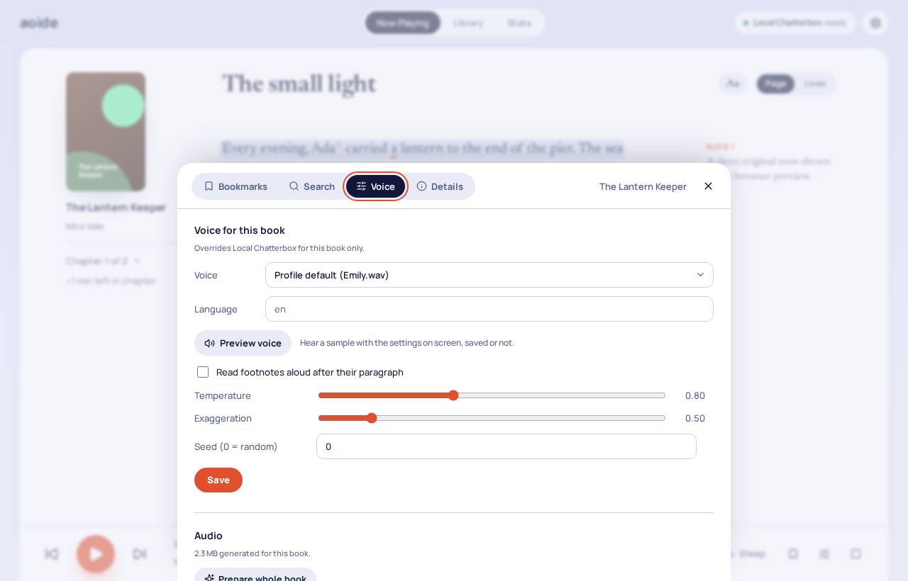<br><sub><b>Per-book voice.</b> Every book can sound different.</sub></td>
  </tr>
</table>

## How it works

<p align="center">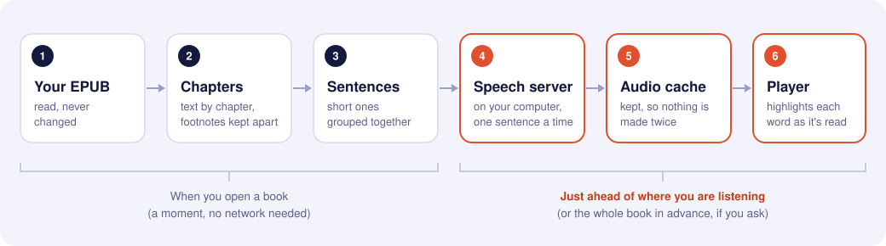</p>

Aoide sends one sentence at a time to the speech server and keeps every piece of audio it gets back, so nothing is made twice. It always works on what you'll hear next:

<p align="center">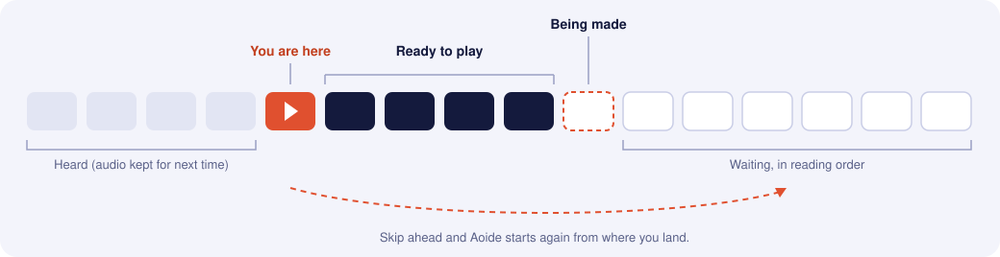</p>

When you skip around, it waits a moment for you to settle and then starts from where you landed. A whole-book preparation steps aside whenever you're listening to something else.

### What leaves your computer

<p align="center">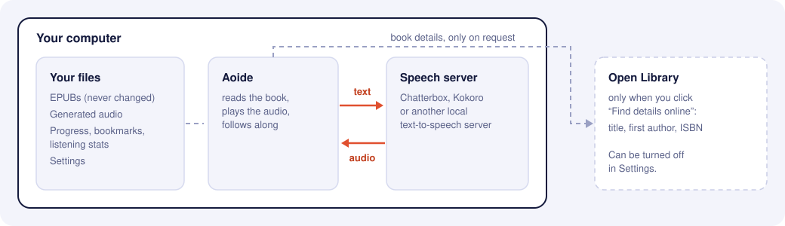</p>

- Book text goes only to the speech server you set up, and by default Aoide refuses any server that isn't on the same computer. If your speech server runs on another machine at home (say, one with a better graphics card), tick *Allow addresses on my home network* in Settings.
- Open Library sees a book's title, first author and ISBN only when you click *Find details online*. You can turn lookups off completely in Settings.
- There is no account, no telemetry and no update check.

## Getting started

You need three things: **Aoide**, a **speech server**, and **some EPUBs** without DRM.

### 1. Build Aoide

Aoide runs on **Linux** today: audio goes through PipeWire or PulseAudio, and media keys through MPRIS.

Install these first:

- [Node.js](https://nodejs.org/) 22.12 or newer, with npm
- [Rust](https://rustup.rs/), stable
- CMake and a C/C++ compiler (for the bundled Opus audio library)
- The [Tauri system libraries](https://v2.tauri.app/start/prerequisites/#linux) for your distribution (WebKitGTK and friends)

<details>
<summary>Example: one command for Fedora, Debian/Ubuntu or Arch</summary>

```sh
# Fedora
sudo dnf install webkit2gtk4.1-devel openssl-devel curl wget file libappindicator-gtk3-devel \
  librsvg2-devel dbus-devel pkgconf-pkg-config gcc-c++ make cmake

# Debian / Ubuntu
sudo apt install libwebkit2gtk-4.1-dev libssl-dev curl wget file libayatana-appindicator3-dev \
  librsvg2-dev libdbus-1-dev pkg-config build-essential cmake

# Arch
sudo pacman -S --needed webkit2gtk-4.1 openssl curl wget file libappindicator-gtk3 librsvg \
  dbus pkgconf base-devel cmake
```

</details>

Then:

```sh
git clone https://github.com/Sebosun/Aoide.git
cd Aoide
npm install
npm run tauri build -- --no-bundle
```

The app is now at `target/release/aoide`. Run it from there, or copy it somewhere on your `PATH`.

### 2. Set up a speech server

Aoide doesn't contain a voice of its own; it talks to a speech server running on your computer. Pick one:

| | Sounds | Needs | Default address |
| --- | --- | --- | --- |
| **[Chatterbox TTS Server](https://github.com/devnen/Chatterbox-TTS-Server)** | Very natural, expressive, can clone a voice from a short sample | An NVIDIA GPU is strongly recommended | `http://127.0.0.1:8004` |
| **[Kokoro-FastAPI](https://github.com/remsky/Kokoro-FastAPI)** | Clear and pleasant, many stock voices | Runs fine on a CPU | `http://127.0.0.1:8880` |
| Anything else with an OpenAI-style `/v1/audio/speech` endpoint | – | – | your choice |

Follow the server's own install guide. Aoide is set up for Chatterbox out of the box; for anything else open **Settings → Speech engine**, choose *OpenAI-compatible speech server* and enter its address.

The pill in the top right corner tells you whether Aoide can reach the server. When it says **ready**, you're set.

> **Tip:** under **Settings → Speech engine → Start the server automatically** you can give Aoide the command that starts your server. It will then start it when needed and you can forget about it.

### 3. Add books

Any of these works:

- Drag `.epub` files onto the window.
- Click **Add EPUB** in the library.
- Click **Find books** to scan your computer for EPUBs you haven't added yet.
- Copy files into `~/Documents/Aoide/Books` yourself. Aoide notices.

Open a book and press play.

## Using Aoide

**Listening.** Press <kbd>Space</kbd> to play or pause and <kbd>←</kbd> <kbd>→</kbd> to move a sentence. Click any sentence to jump there. If you scroll away while listening, the page stops following you until you click *Back to playhead*.

**Preparing ahead.** On a book's page, **Prepare whole book** makes all its audio in the background, so it plays instantly later, even with the speech server off. Click the engine pill in the top bar to see the queue, pause it or cancel. Unfinished books carry on next time you start Aoide (you can turn that off under **Settings → Library**).

**A voice per book.** In the reader, open the book tools (the sliders icon in the player) and go to **Voice**. Choose a voice, language and settings for just this book, and press **Preview voice** to hear a sample before saving. Changing the voice later lets you regenerate the book's audio.

**Exporting.** **Export as M4B**, in a book's menu in the library or under **Voice** in the book tools, saves an audiobook file with chapter marks and cover to `~/Documents/Aoide/Exports`. This needs [`ffmpeg`](https://ffmpeg.org/) installed.

**Storage.** Generated audio is kept so nothing is made twice. Set a size limit in **Settings → Storage**; the oldest audio goes first, never the book you're listening to or preparing.

**Exact word timing (optional).** By default Aoide places each word by listening for the pauses in the audio, which is close but not perfect. For word-exact highlighting, run the small aligner in [`tools/aligner`](tools/aligner/aoide_aligner.py) in any Python environment with `torch` and `torchaudio` 2.1+ (your Chatterbox environment works):

```sh
python tools/aligner/aoide_aligner.py --port 8890
```

Then turn on **Settings → Word highlighting → Exact word timing** with the address `http://127.0.0.1:8890`. The first start downloads a 1.2 GB model. It uses about 1 GB of video memory; add `--device cpu` to keep the GPU free for your speech server, at about half a second per sentence. Each sentence is aligned once, just before it plays. Words the model can't spell (numbers, non-Latin scripts) fall back to the estimate.

### Keyboard shortcuts

| Keys | Does |
| --- | --- |
| <kbd>Space</kbd> | Play or pause |
| <kbd>←</kbd> / <kbd>→</kbd> | Previous or next sentence |
| <kbd>Ctrl</kbd> <kbd>F</kbd> | Search the open book, or the library |
| <kbd>Ctrl</kbd> <kbd>,</kbd> | Settings |
| <kbd>Ctrl</kbd> <kbd>+</kbd> / <kbd>Ctrl</kbd> <kbd>−</kbd> / <kbd>Ctrl</kbd> <kbd>0</kbd> | Larger, smaller, or normal interface size (or <kbd>Ctrl</kbd> + mouse wheel) |
| <kbd>Esc</kbd> | Close a dialog or menu |

The same list is in **Settings → About**.

## Where your files live

| What | Where |
| --- | --- |
| Your books | `~/Documents/Aoide/Books` (add your own scan folders under **Find books**) |
| Exported audiobooks | `~/Documents/Aoide/Exports` |
| Settings | `~/.config/aoide/settings.toml` |
| Colour themes | `~/.config/aoide/themes/*.toml` |
| Library, progress, bookmarks, covers | `~/.local/share/com.aoide.audiobooks` |
| Generated audio | `~/.cache/com.aoide.audiobooks` (safe to delete; it's made again when needed) |

Books are recognised by their content, not their file name, so renaming or moving a file keeps your progress. If a file disappears, the book stays in your library as *missing* and comes back when the file does.

<details>
<summary>Editing settings by hand, and custom colour themes</summary>

`settings.toml` holds appearance, playback speed, app settings and the speech engine. Edit it while Aoide is running and the changes apply as soon as you save.

A colour theme is a file in `~/.config/aoide/themes/` with a `[light]` and a `[dark]` table of colour tokens, for example:

```toml
[light]
accent = "#E0502F"

[dark]
accent = "#FF6A3D"
```

Pick it under **Settings → Appearance**. Per-book settings, progress and bookmarks live in the library database, not here.

</details>

<details>
<summary>Coming from Folio?</summary>

Aoide was called Folio until November 2026. The first time Aoide starts, it moves Folio's folders (`~/.config/folio`, `~/Documents/Folio`, and the `com.folio.audiobooks` data and cache folders) to the new names and updates the paths in your library. Nothing is overwritten. If you start any helper with a path inside the old folders (for example a launch command), update that path.

</details>

## Troubleshooting

**The pill in the top bar says the engine is offline.** Aoide can't reach the speech server. Check that it's running and that the address in **Settings → Speech engine** matches the one the server prints when it starts. If the server is on another computer, tick *Allow addresses on my home network*.

**Play does nothing, or there's no sound.** Aoide plays through `pw-cat` (PipeWire), `paplay` (PulseAudio) or `aplay` (ALSA), whichever it finds first. Make sure one of them is installed; on most desktops `pw-cat` already is.

**It pauses now and then to catch up.** The speech server is slower than you're listening. Lower the playback speed, use a faster engine, or prepare the book ahead of time.

**A book's chapters look wrong, or some text is missing.** In the reader, open the book tools and go to **Details**: *Extraction notes* lists anything Aoide left out (copyright pages, tables of contents and the like) and why, plus any warnings. Some EPUBs have poor navigation, so chapters may be grouped differently from the printed book. Your file is never modified.

**Export as M4B is missing or fails.** Install `ffmpeg` and make sure it's on your `PATH`.

**The word highlight drifts a little.** That's the estimate at work. Try *Exact word timing* above.

Still stuck? [Open an issue](https://github.com/Sebosun/Aoide/issues) and say what you did, what you expected and what happened.

## For developers

Aoide is a [Tauri 2](https://v2.tauri.app/) app: the core is Rust, the interface is Vue 3 + TypeScript.

```sh
npm install
npm run tauri dev    # the desktop app, with hot reload
npm run dev          # the interface alone in a browser, with sample books and fake audio
npm test             # Rust tests for all library crates (no GPU or WebKit needed)
npm run test:ui      # interface tests (Vitest)
npm run typecheck    # Vue templates + TypeScript
npm run check        # rustfmt + Clippy, warnings denied
```

The browser preview at `http://127.0.0.1:1420` runs the whole interface against a mock backend with original sample books. URL parameters such as `?view=reader&theme=dark&mode=lines` open a screen in a known state; see [`src/preview.ts`](src/preview.ts).

<details>
<summary>Project layout</summary>

| Crate | What it does |
| --- | --- |
| [`crates/epub-parser`](crates/epub-parser/README.md) | Reads an EPUB into ordered chapters of typed blocks, with metadata, cover, excluded front/back matter (with reasons) and warnings. Deterministic, no network. |
| `crates/segmenter` | Splits text into sentences and speech segments with stable ids; estimates word timings. |
| `crates/tts` | The `SpeechEngine` trait every engine implements, settings descriptors for the UI, address rules, cache keys, and a conformance kit for adapters. |
| [`crates/chatterbox-client`](crates/chatterbox-client/README.md) | Chatterbox TTS Server adapter. |
| `crates/openai-speech` | Adapter for OpenAI-compatible `/v1/audio/speech` servers. |
| `crates/generation` | Decides what to make next (playhead first) and runs one request at a time. |
| `crates/audio` | Ogg Opus encoding, the gapless, time-stretching player, and output to `pw-cat`/`paplay`/`aplay`. |
| `crates/library` | SQLite store for books, progress, the audio cache index, bookmarks, stats and per-book settings. |
| `crates/discovery` | Fast parallel EPUB search on disk for *Find books*. |
| `crates/metadata` | Open Library search, descriptions and covers. |
| `crates/aligner` | Client for the optional forced aligner in `tools/aligner`. |
| `crates/config` | `settings.toml` and colour themes. |
| `src-tauri` | Wires it all together: commands, events, and the core's state machines. |
| `src` | The Vue interface. `src/api/contract.ts` is generated from the Rust types. |

</details>

- **Add a speech engine:** if it speaks the OpenAI speech API, it already works. Otherwise implement one Rust trait; see [docs/adding-an-engine.md](docs/adding-an-engine.md).
- **Conventions** (tests first, explicit state machines, BEM in Vue, keeping personal books out of Git): [AGENTS.md](AGENTS.md).
- **What's next:** [docs/roadmap.md](docs/roadmap.md).

Test books are tiny EPUBs generated in the tests from original text. Please keep real books and generated audio out of the repository.

## Licence

[MIT](LICENSE). The bundled Manrope and Newsreader fonts are under the [SIL Open Font License](src/assets/fonts/OFL-Newsreader.txt).
